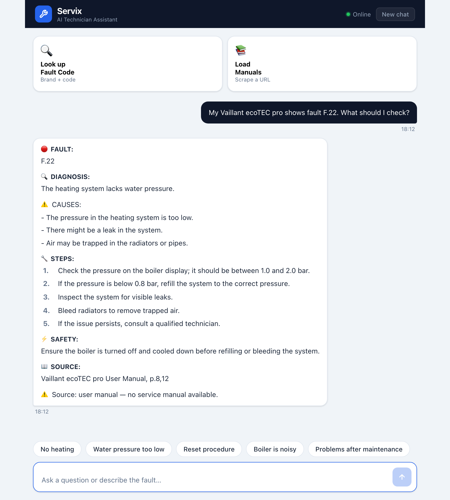
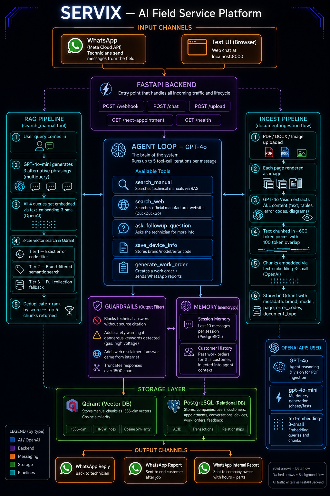

# Servix — AI Field Service Assistant

**A WhatsApp assistant that helps heating and HVAC technicians troubleshoot boilers and heat pumps on site, answering only from the official service manuals, always with the source page.**


[](https://github.com/DomienDarmontAntwerpen/servix/actions/workflows/tests.yml)

> **In short:** a technician standing in front of a broken boiler sends a WhatsApp message like *"Vaillant ecoTEC pro shows F.22"*. Servix searches the manufacturer's manuals and replies within seconds with a diagnosis, likely causes, step-by-step actions, a safety warning, and the manual page it came from. If the manuals don't cover it, Servix says so instead of guessing.



---

## What it does

- **Troubleshoots fault codes** from service manuals (Vaillant, Bulex, Remeha, Daikin and others) in short replies built for WhatsApp.
- **Never invents information**: answers without a source citation are blocked by an output guardrail.
- **Adds safety warnings automatically** when an answer involves gas, high voltage or other hazards.
- **Falls back to the web only with permission**, with a clear disclaimer that the information is unofficial.
- **Ingests any manual**: PDFs are rendered page by page and read by GPT-4o Vision, so tables, diagrams and error-code lists are captured as well.
- **Remembers context**: conversation history per technician, stored in PostgreSQL.
- **Multi-tenant data model**: each installation company has its own technicians and data.
- **Bilingual**: Dutch by default, English when the technician writes in English, in both the answers and the chat interface.

## How it works

1. **Ingest**: each manual page is rendered as an image, GPT-4o Vision extracts its content, and the text is chunked, embedded and stored in Qdrant with brand, model and error-code metadata.
2. **Retrieve**: the question is rewritten into several variants (multi-query) and searched in three tiers: an exact error-code match, then a brand-filtered semantic search, then the full collection.
3. **Agent loop**: GPT-4o decides per message which tool to use: `search_manual` (RAG over the manuals), `search_web` (official manufacturer sites, only after the technician agrees) or `ask_followup_question` (when brand, model or error code is missing).
4. **Guardrails**: every reply is checked for a source citation, safety warnings and length before it is sent.

<details>
<summary>Full architecture diagram</summary>



*Target architecture. The work-order and device-history parts are on the roadmap.*
</details>

## Tech stack

| Layer | Technology |
|---|---|
| Backend | FastAPI (async) |
| LLM | GPT-4o (agent + vision), GPT-4o-mini (query rewriting) |
| Embeddings | text-embedding-3-small |
| Vector database | Qdrant |
| Relational database | PostgreSQL (`asyncpg`) |
| Messaging | Twilio WhatsApp API |
| Document parsing | PyMuPDF, python-docx, Playwright (manual scraping) |
| Deployment | Docker Compose |
| Testing | pytest |

## Getting started

### Prerequisites
- Docker Desktop
- An OpenAI API key
- Optional: a Twilio account for the WhatsApp channel (the browser chat works without it)

### Installation
```bash
git clone https://github.com/DomienDarmontAntwerpen/servix.git
cd servix
```

### Configuration
```bash
cp .env.example .env
```
Fill in `OPENAI_API_KEY`. The Twilio fields are only needed for WhatsApp.

### Run
```bash
docker compose up -d --build
docker compose exec backend python seed.py   # creates the demo company (first run only)
curl http://localhost:8000/health            # {"status":"ok","postgres":"ok","qdrant":"ok"}
```
- Technician chat: http://localhost:8000
- Manual admin (upload or scrape manuals): http://localhost:8000/boss
- Upload a manual: place PDFs in `docs/<brand>/` and call `POST /upload/folder?folder=<brand>`, or upload one through `POST /upload`.

Manufacturer manuals are copyrighted, so they are not included in this repository. Servix is built for Flemish technicians: it answers in Dutch by default and in English when the question is in English. The technician chat follows the browser language (Dutch or English; force one with `?lang=nl` or `?lang=en`).

## Running the tests
```bash
pip install pytest
pytest
```
The tests cover the output guardrails (source enforcement, safety warnings, web disclaimers, length limits) and language detection.

## Project structure
```
servix/
├── backend/
│   ├── main.py          # FastAPI routes: /chat, /webhook, /upload, /health
│   ├── agent.py         # Tool-calling agent loop (GPT-4o)
│   ├── rag.py           # Multi-query, three-tier retrieval from Qdrant
│   ├── ingest.py        # PDF/DOCX/image ingestion with GPT-4o Vision
│   ├── guardrails.py    # Output validation (sources, safety, length)
│   ├── language.py      # Detects whether to answer in Dutch or English
│   ├── memory.py        # Conversation and customer history (PostgreSQL)
│   ├── whatsapp.py      # Twilio WhatsApp integration
│   ├── prompts.py       # All system prompts in one place
│   ├── schema.sql       # Database schema
│   ├── static/          # Web chat interface
│   ├── Dockerfile
│   └── requirements.txt
├── docs/                # Manuals per brand (not committed)
├── tests/
├── docker-compose.yml
└── .env.example
```

## Status & next steps
A working prototype, tested end to end with real manuals. Next steps: work orders and device history per customer (already in the architecture design), and voice messages.

The web chat and the document-upload endpoints are a local, single-user demo: they have no login and share one demo session. WhatsApp traffic is separated per technician. Before running it for real customers, the next step is authentication on the admin and upload endpoints.

## Author
**Domien Darmont** — Operational leader building applied AI systems, Antwerp, Belgium  
GitHub: [@DomienDarmontAntwerpen](https://github.com/DomienDarmontAntwerpen)  
LinkedIn: [Domien Darmont](https://www.linkedin.com/in/domien-darmont-b53b7640b/)

A live demo, the project presentation or answers to any questions are available on request.

## License
© 2026 Domien Darmont. All rights reserved.

The source code of this project is published for viewing and evaluation only. No permission is granted to copy, modify, distribute or use it, in whole or in part, without prior written consent from the author.
